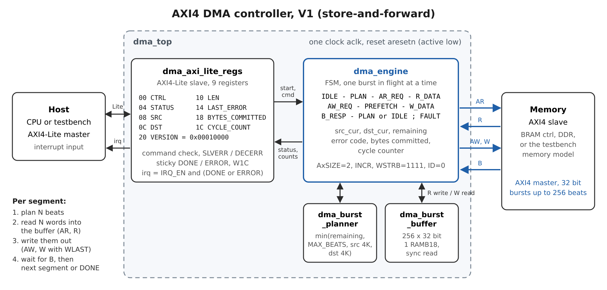
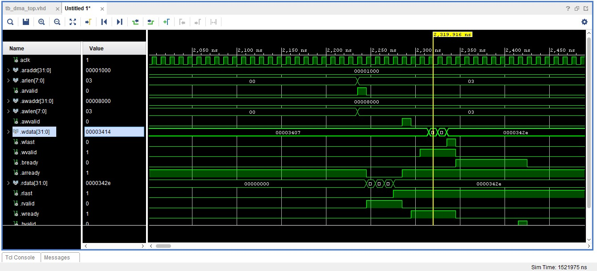
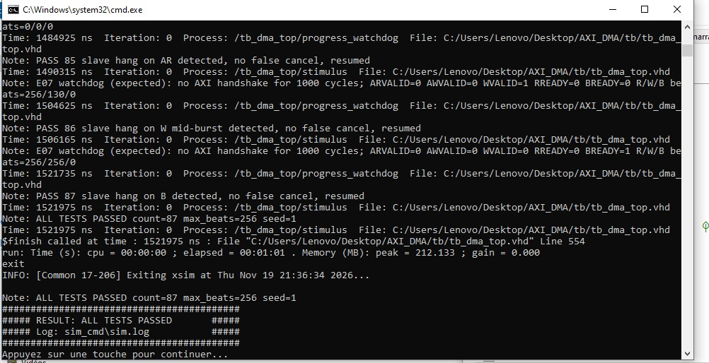
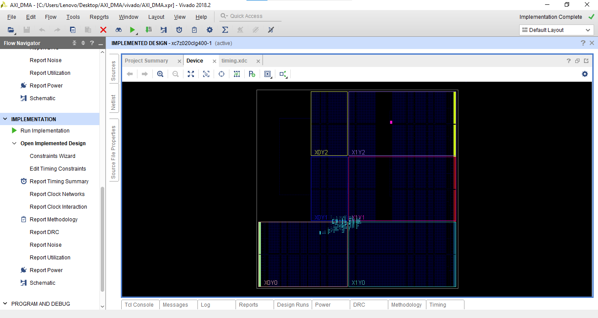
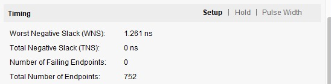

# AXI4 DMA Controller

**32-bit memory-to-memory DMA in VHDL-2008 — RTL design, functional verification, and FPGA characterization.**

The processor provides a source address, a destination address, and a byte count. The DMA then copies the data through an AXI4 burst master and reports completion through AXI4-Lite status registers and an optional interrupt.

V1 uses a **store-and-forward architecture**: read one segment into a buffer, write it, wait for its write response, and then begin the next segment. The target is a **Zynq-7000 `xc7z020clg400-1` at 100 MHz**.



*AXI4-Lite carries software commands. AXI4 carries memory traffic. The planner and buffer support the transfer engine.*

[Architecture](docs/ARCHITECTURE.md) · [Copy walkthrough](docs/WALKTHROUGH.md) · [Registers](docs/REGISTER_MAP.md) · [Error handling](docs/ERROR_POLICY.md) · [Verification](docs/VERIFICATION.md) · [Results](docs/RESULTS.md) · [Image gallery](docs/IMAGE_GALLERY.md)

## Project at a glance

| Item | V1 |
|---|---|
| Implementation language | VHDL-2008 |
| Control interface | AXI4-Lite slave, 32-bit data, 6-bit register address |
| Memory interface | AXI4 master, 32-bit data and addresses, `INCR` bursts |
| Burst size | Configurable from 1 to 256 beats; 4 bytes per beat |
| Buffer | 256 × 32-bit synchronous RAM; one RAMB18 in the reported build |
| Scheduling | One segment at a time; no read/write overlap |
| Boundary protection | Split bursts at both source and destination 4 KiB boundaries |
| Completion | Only after the final successful write response |
| Tools used in the project | Vivado 2018.2 / XSim and GHDL 4.1.0 |

The repository includes the **complete V1 RTL**, two testbenches, simulation and build scripts, constraints, reference logs/CSVs, Vivado reports, and illustrated English documentation. Generated Vivado caches and simulator executables are rebuilt from source. The results below come from the supplied reference runs; see [reproduction instructions](docs/REPRODUCING.md) to run them with the original tools.

## Quick start

Clone the repository:

```sh
git clone https://github.com/seddouki18/AXI4-DMA-Controller.git
cd AXI4-DMA-Controller
```

**Windows / Vivado 2018.2:**

```bat
scripts\run_sim.bat
scripts\run_build.bat
```

The batch scripts expect Vivado in `C:\Xilinx\Vivado\2018.2`; update their settings path if needed. The simulation verdict is `ALL TESTS PASSED count=87 max_beats=256 seed=1`.

**Linux / GHDL 4.1.0:**

```sh
bash scripts/regress_ghdl.sh 1:256    # One 87-test reference run
bash scripts/regress_ghdl.sh          # Full 62-configuration campaign
```

To create a fresh Vivado GUI project, run `vivado -mode batch -source scripts/create_vivado_project.tcl`, then open `build/vivado/AXI_DMA.xpr`. The generator is included for portability; validation inside Vivado is still required. [Full setup, waveform, planner-test, and mutation instructions](docs/REPRODUCING.md).

## How a copy works

1. Software writes `SRC`, `DST`, and `LEN`, then sets `START`.
2. The register block checks alignment, length, address overflow, and overlapping ranges.
3. The planner chooses a segment that fits the burst limit and both 4 KiB page boundaries.
4. The engine reads the segment into RAM, then writes the buffered words to the destination.
5. A successful write response adds the segment to `BYTES_COMMITTED`. The engine repeats or sets `DONE`.

The transfer follows this normal state sequence:

```text
IDLE → PLAN → AR_REQ → R_DATA → AW_REQ → PREFETCH → W_DATA → B_RESP
          ↑                                                    │
          └──────────── another segment ────────────────────────┘
                                                        last segment → IDLE + DONE
```

For example, copying **16 bytes from `0x1000` to `0x8000`** needs four read beats and four write beats. `WLAST` marks the fourth write beat; completion waits for the B response. The reference simulation records **20 cycles** for this copy. [Follow the signals step by step.](docs/WALKTHROUGH.md)



*Native XSim capture: the read transaction finishes before the write transaction, and the write response follows the last data beat.*

## Verification and measured results

| Result | Reported value | Available evidence |
|---|---|---|
| Reference XSim suite | **87 / 87 tests PASS**, seed 1, maximum 256 beats | [XSim screenshot](docs/images/simulation/xsim-87-tests-passed.png) and [raw reference log](reports/xsim_reference.log) |
| Reference GHDL suite | **87 / 87 tests PASS** | [Per-test results](reports/tests_seed1_b256.csv) |
| GHDL regression | **62 / 62 configurations PASS** | [Regression CSV](reports/regression_ghdl.csv) |
| Mutation checks | **12 / 12 injected bugs detected** | [Mutation CSV](reports/mutation_ghdl.csv) and [coverage summary](reports/TEST_SUMMARY.md) |
| 1 KiB copy, no stalls | **524 cycles; 195 MB/s at 100 MHz** | Simulation benchmark with the testbench memory model |
| FPGA resources | **604 LUT, 378 FF, 1 RAMB18, 0 DSP** | [Vivado resource screenshot](docs/images/implementation/resource-summary.png) |
| Timing at 100 MHz | **WNS +1.261 ns; WHS +0.083 ns** | [Setup](docs/images/implementation/timing-setup.png) / [hold](docs/images/implementation/timing-hold.png) screenshots |



*The final console message identifies the test count, seed, and maximum burst length. The full verification page explains what the suite checks and what remains outside its scope.*

The testbench checks the **whole memory**, AXI payload stability during stalls, exact `LAST` placement, burst boundaries, error responses, and completion ordering. It also tests memory slaves that stop responding. Its progress watchdog is a simulation check; **V1 has no internal hardware timeout**.

V1's ideal copy-rate bound is **2 bytes per cycle** because reading and writing happen in separate phases. The 1 KiB benchmark reaches about **97.7%** of that bound with the reference memory model. These are simulation results, not board measurements.

The timing result covers the **isolated block's internal register-to-register paths**. AXI port paths are not constrained in the OOC run. Complete-system timing still requires integration. [Read the results and timing scope.](docs/RESULTS.md)

## Implemented design in Vivado



*The DMA design in Vivado's Device window, with the implemented design open and Implementation Complete visible. This shows the block in the FPGA fabric; it is not a board measurement.*



*Positive setup margin at the 100 MHz reference clock. See the [full timing report](reports/timing_summary.rpt) and [scope of the OOC constraints](constraints/BOUNDARY_ASSUMPTIONS.md).*

## Supported transfers and error behavior

- Source, destination, and length are multiples of 4; length must be positive.
- Source and destination ranges must not overlap or overflow the 32-bit address space.
- Burst addresses increment by 4 bytes; IDs are fixed to 0 and master write strobes are `1111`.
- An ordinary read error drains the burst and prevents that segment from being written.
- A write error stops subsequent segments; earlier successful segments remain committed.
- Malformed `RLAST`, `RID`, or `BID` enters `FAULT`; recovery requires a coordinated external reset.

V1 has one clock domain. Unaligned transfers, scatter-gather, circular operation, cache coherency, and read/write overlap are outside its supported subset. [See the error policy.](docs/ERROR_POLICY.md)

## Repository layout

```text
rtl/           Six synthesizable VHDL-2008 modules
tb/           Top-level self-checking suite and standalone planner test
scripts/       XSim/GHDL simulation, regression, mutation, and Vivado builds
constraints/   100 MHz clock constraint and OOC boundary assumptions
reports/       Reference logs, per-test/campaign CSVs, and Vivado reports
docs/          English explanations, image gallery, and original reference PDFs
vivado/        Instructions for generating a portable GUI project
```

The sources retain the supplied design. The publication adds English explanations, organized figures, and a portable GUI-project creation script.

## Documentation and image collection

| Page | What it explains |
|---|---|
| [Architecture](docs/ARCHITECTURE.md) | Modules, AXI channels, handshake, planner, RAM, and state machine |
| [Copy walkthrough](docs/WALKTHROUGH.md) | Register programming, nominal copy, page splitting, stalls, and errors |
| [Register map](docs/REGISTER_MAP.md) | Control/status bits, offsets, counters, and interrupt behavior |
| [Error policy](docs/ERROR_POLICY.md) | Error codes, committed bytes, and recovery |
| [Verification](docs/VERIFICATION.md) | Scoreboard, monitors, coverage, regression, and mutation checks |
| [Results](docs/RESULTS.md) | Native evidence screenshots, resource usage, timing, and performance |
| [Image gallery](docs/IMAGE_GALLERY.md) | Every supplied image, with an English caption |
| [Reproduction](docs/REPRODUCING.md) | Simulation, regression, mutation checks, OOC build, and GUI project setup |
| [Boundary assumptions](constraints/BOUNDARY_ASSUMPTIONS.md) | Detailed scope of the out-of-context timing run |
| [Original technical report — French](docs/reference/AXI_DMA_V1_Technical_Report_FR.pdf) | 54-page source report, including RTL excerpts and the 87-test list |
| [Simulation summary — French](docs/reference/AXI_DMA_Simulation_Summary_FR.pdf) | Original concise simulation summary |

The navigation and explanations are in English. Original screenshots and some drawings retain their original French labels; their captions explain them in English. Native tool captures are identified separately from explanatory diagrams and redrawn chronograms.

## Planned V2

V2 is planned, not implemented in the supplied material. It will use two buffer banks so that reading segment *n + 1* can overlap writing segment *n*. The goal is to improve throughput and compare both versions with the same clock, memory model, and regression seeds.

Full Zynq-system integration, a software driver, board testing, and frequency sweeps are also future work.

## Author

**SEDDOUKI Nacereddine** — Master's student in Embedded Systems and Robotics (MST-SER), FST Al Hoceima.  
RTL design and functional verification project, November 2026.
