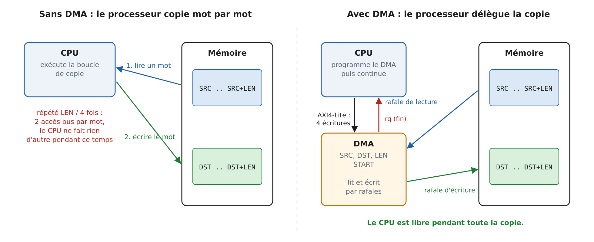
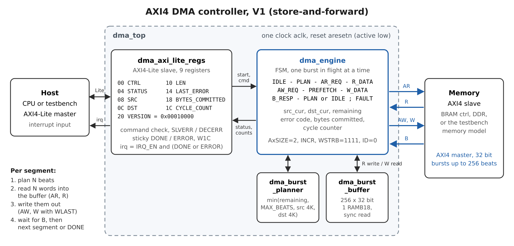
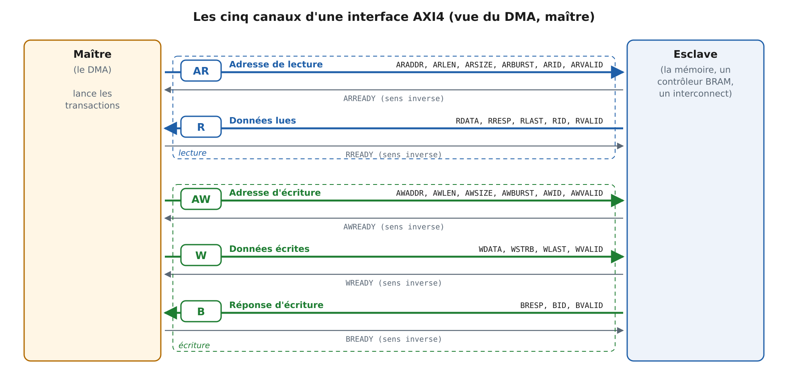
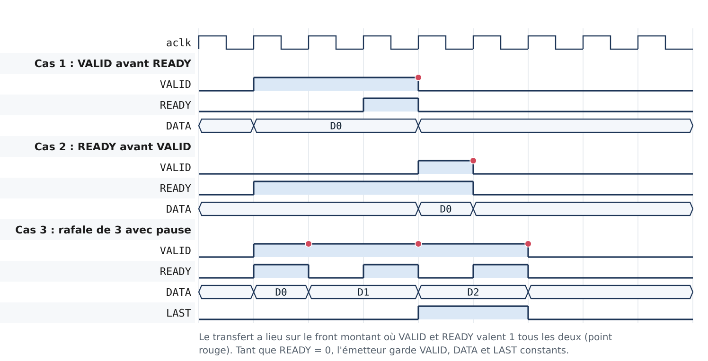
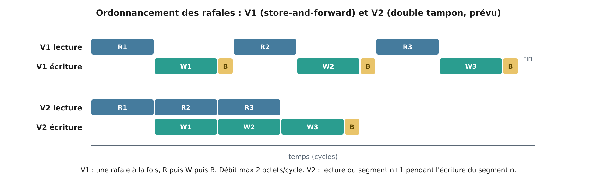
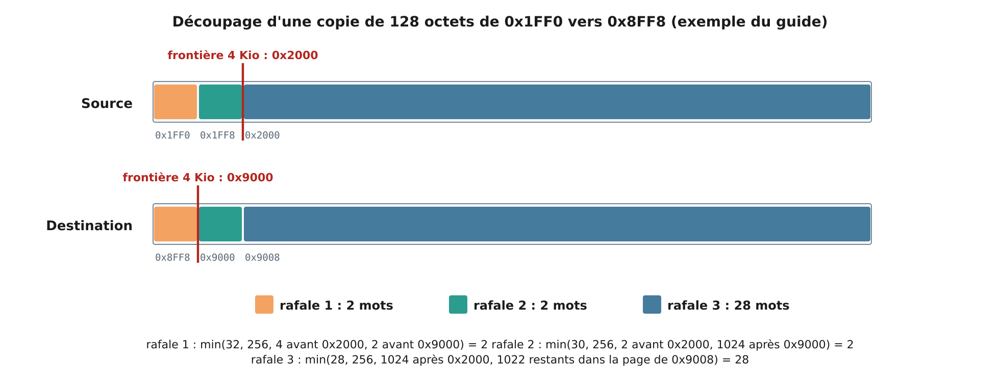
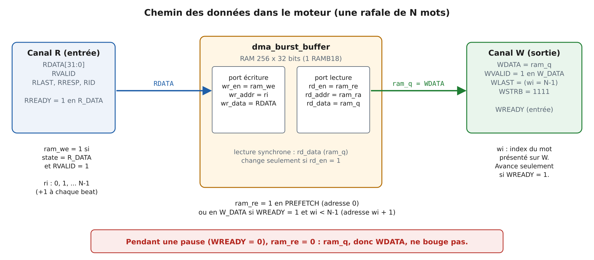
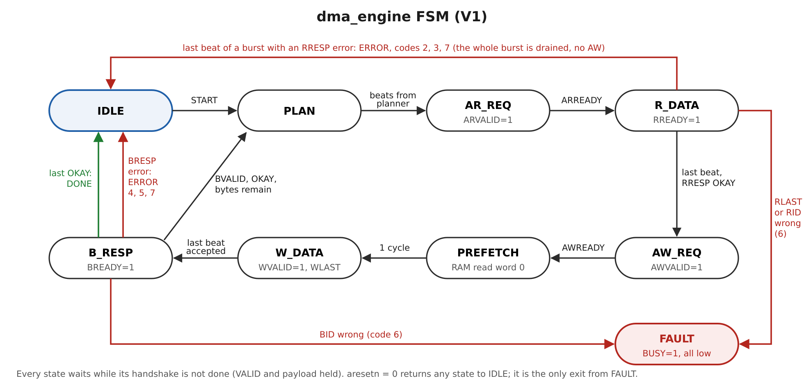

# Architecture and operation

[Project overview](../README.md) · [Register map](REGISTER_MAP.md) · [Error handling](ERROR_POLICY.md) · [Verification](VERIFICATION.md) · [Results](RESULTS.md)

The V1 DMA copies a block of memory from a source address to a destination address. Software programs the operation through AXI4-Lite registers. The DMA then generates AXI4 read and write bursts itself and reports completion through status bits and an optional interrupt.

The design uses VHDL-2008, 32-bit addresses and data, one clock domain, and one burst buffer. Its reference implementation targets the Zynq-7000 `xc7z020clg400-1` at 100 MHz.

## Why use a DMA?

Without a DMA, software must repeatedly read a word and write it to another address. With this controller, software supplies the source, destination and byte count, starts the operation, and can perform other work while the controller transfers the data.



*The source figure uses French labels: “processeur” means processor and “mémoire” means memory. The left side shows a software copy; the right side shows a transfer delegated to the DMA.*

## The main blocks



*The AXI4-Lite interface carries commands and status. The AXI4 master interface carries the copied data. Internal connections carry the command, progress counters and completion events.*

| Block | Responsibility |
|---|---|
| `dma_pkg` | Defines shared AXI records, fixed bus attributes, byte-strobe handling and command validation. |
| `dma_axi_lite_regs` | Receives software accesses, stores the command, checks it before START, and exposes status, counters and the interrupt. |
| `dma_burst_planner` | Chooses the next burst length from the remaining data, the configured limit and both 4 KiB boundaries. |
| `dma_burst_buffer` | Stores the words of one read burst until they can be written to the destination. |
| `dma_engine` | Runs the state machine, controls the AXI4 channels, checks responses and maintains progress counters. |
| `dma_top` | Connects the external ports to the register block and engine. The engine contains the planner and buffer. |

## Two interfaces with different jobs

**AXI4-Lite** is the control interface. Software writes `SRC`, `DST` and `LEN`, then sets START. It can read `STATUS`, `LAST_ERROR`, `BYTES_COMMITTED` and `CYCLE_COUNT` to observe the operation. The register interface accepts write address and write data independently, so either can arrive first.

**AXI4** is the memory interface. It has five independent channels:

| Channel | What it carries |
|---|---|
| AR | Source read address and burst attributes. |
| R | Read data and per-beat response status. |
| AW | Destination write address and burst attributes. |
| W | Write data, byte strobes and the last-beat indication. |
| B | One response confirming or rejecting the write burst. |



*“Lecture” means read and “écriture” means write. AR and R form the read side; AW, W and B form the write side.*

Every AXI4 data beat is four bytes. The DMA uses incrementing bursts, `AxSIZE = 2`, `AxBURST = INCR`, master `WSTRB = 1111`, and IDs fixed to zero. A burst can contain from 1 to `MAX_BURST_BEATS` beats, with a supported maximum of 256.

### VALID and READY

A beat transfers on a rising clock edge only when VALID and READY are both high. If the receiver lowers READY, the sender keeps VALID asserted and holds the payload stable until the transfer is accepted. This is how the design tolerates a memory or interconnect pause without losing a word.



*The examples show immediate acceptance and acceptance after a pause. Each marked transfer occurs when both signals are high on the clock edge; data remains unchanged while waiting.*

## V1 uses store-and-forward

Each segment follows the same sequence:

1. Calculate a legal burst length.
2. Send the source read address and receive the entire burst into the buffer.
3. If the read burst completed without errors, send the destination write address.
4. Send the buffered data and wait for the B response.
5. Count the bytes only after an OKAY B response, then start the next segment if needed.



*“Lecture” is the read phase, “écriture” is the write phase, and “tampon” means buffer. V1 completes the read phase before starting the write phase and waits for B before the next read.*

This ordering makes error handling explicit: a segment with a read response error is never sent to the write channel. It also sets the main performance limit. Reading and writing do not overlap in V1, so a copied four-byte word requires a read beat and a write beat. The large-transfer bound is therefore two copied bytes per clock before transaction overhead and pauses.

V2 is a planned extension with two buffers, allowing a later segment to be read while an earlier one is written. That overlap is not implemented in V1.

## Choosing the next burst

The planner uses the smaller of four limits, expressed in four-byte words:

```text
next_beats = min(
    remaining_bytes / 4,
    MAX_BURST_BEATS,
    (4096 - (source_address mod 4096)) / 4,
    (4096 - (destination_address mod 4096)) / 4
)
```

The same segment length is used for the read and write bursts. Checking both addresses prevents either transaction from crossing a 4 KiB boundary. The engine registers the planner's result during `PLAN` before it sends the read address.

For example, copying 128 bytes from `0x1FF0` to `0x8FF8` produces three bursts:

| Segment | Source | Destination | Beats | Bytes | Why the burst ends |
|---|---|---|---:|---:|---|
| 1 | `0x1FF0` | `0x8FF8` | 2 | 8 | Destination reaches `0x9000`. |
| 2 | `0x1FF8` | `0x9000` | 2 | 8 | Source reaches `0x2000`. |
| 3 | `0x2000` | `0x9008` | 28 | 112 | All remaining bytes are copied. |



*“Frontière” means boundary and “rafale” means burst. The example is split into 2, 2 and 28 beats because the source and destination reach their page boundaries at different times.*

## The synchronous burst buffer

At the default depth, the buffer holds 256 words of 32 bits: 1 KiB of data. The reported implementation uses one RAMB18 primitive. It is a burst buffer with distinct fill and drain phases.



*“Chemin des données” means data path. Read data enters the RAM; the RAM's registered output supplies WDATA during the write phase.*

Reads and writes are synchronous. During `R_DATA`, each accepted R beat is stored at the current read-beat index. After AW is accepted, the one-cycle `PREFETCH` state loads word zero into the RAM output register.

That output register also holds the current WDATA. The engine requests the next RAM word only when WREADY accepts the current word and another word remains. If WREADY is low, the RAM read enable stays low and WDATA remains stable. WVALID and WLAST also remain stable until the current beat is accepted.

The RAM array is not reset. The engine always fills a segment before reading it back, so unused previous contents do not affect a transfer.

## Engine state machine



*The main path follows one segment from planning to acknowledgement. Normal completion returns to IDLE; protocol violations lead to FAULT.*

| State | Action | Next step |
|---|---|---|
| `IDLE` | No transfer is active; BUSY is low. | An accepted START latches the command and enters `PLAN`. |
| `PLAN` | Latch the planned burst length and reset beat indices. | Enter `AR_REQ` after one cycle. |
| `AR_REQ` | Hold ARVALID and the source burst description. | Enter `R_DATA` after AR is accepted. |
| `R_DATA` | Receive the burst, fill the buffer, and check RRESP, RLAST and RID. | Enter `AW_REQ` after a correct burst; report a response error or enter `FAULT` on a protocol violation. |
| `AW_REQ` | Hold AWVALID and the destination burst description. | Enter `PREFETCH` after AW is accepted. |
| `PREFETCH` | Load buffer word zero into the RAM output register. | Enter `W_DATA` after one cycle. |
| `W_DATA` | Send buffered words; assert WLAST only for the final word. | Enter `B_RESP` after the final W beat is accepted. |
| `B_RESP` | Wait for the write response and check BRESP and BID. | On OKAY, commit the segment and repeat or finish; otherwise report an error or enter `FAULT`. |
| `FAULT` | Suppress master handshakes and keep BUSY high. | A coordinated external reset is required. |

`DONE` is an event and a sticky status bit, not a separate engine state. It is generated only after an OKAY response for the final write burst. See [Error handling](ERROR_POLICY.md) for the difference between recoverable response errors and protocol faults.

## Reset and supported commands

`aresetn` is active low and must be synchronous to `aclk`. It resets the control registers and engine on the clock edge; it also suppresses VALID and READY outputs while low. `SOFT_RESET` is a software command accepted only while the engine is idle, and cannot release `FAULT`.

A command must have nonzero length, four-byte-aligned source and destination addresses, and a length divisible by four. Neither address range may extend beyond the 32-bit address space, and the source and destination ranges must not overlap. The current design has no unaligned transfers, scatter-gather mode, circular mode, cache coherency or internal timeout.

The implementation is available in [rtl/](../rtl), with the [self-checking testbenches](../tb), [simulation and build scripts](../scripts), and [original technical report](reference/AXI_DMA_V1_Technical_Report_FR.pdf). See [Verification](VERIFICATION.md) for the checks and campaign evidence and [Reproducing the results](REPRODUCING.md) for the tool workflow.
