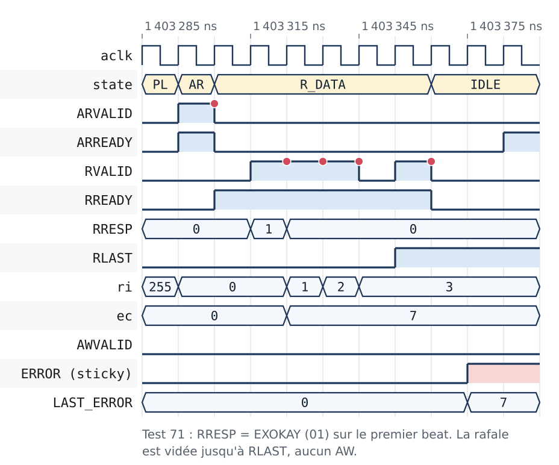
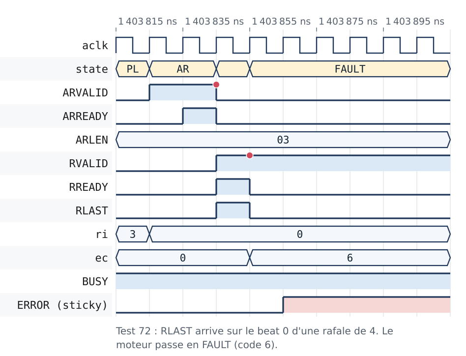

# Error handling and recovery

[Project overview](../README.md) · [Architecture](ARCHITECTURE.md) · [Register map](REGISTER_MAP.md) · [Verification](VERIFICATION.md)

V1 distinguishes a memory response error from a broken transaction protocol. A normal response error ends the current command and returns the engine to idle. A malformed RLAST or unexpected ID enters FAULT and requires coordinated external reset.

The controller never reports DONE simply because it has sent the last data word. Successful completion requires an OKAY B response for every segment, including the last one. The behavior below follows [dma_engine.vhd](../rtl/dma_engine.vhd) and [dma_axi_lite_regs.vhd](../rtl/dma_axi_lite_regs.vhd).

## LAST_ERROR codes

| Value | Name | Trigger | Engine behavior | Recovery |
|---:|---|---|---|---|
| 0 | None | No recorded error. | Normal operation. | No recovery needed. |
| 1 | Invalid command | Zero length, misalignment, address-range overflow or overlapping source and destination. | Reject START with AXI4-Lite SLVERR; set ERROR; issue no memory transaction. | Correct the command while idle and start again. |
| 2 | Read SLVERR | An R beat has `RRESP = SLVERR`. | Drain the read burst, discard this segment and report ERROR. | Start a new valid command after addressing the cause. |
| 3 | Read DECERR | An R beat has `RRESP = DECERR`. | Same read-side behavior as code 2. | Start a new valid command after addressing the cause. |
| 4 | Write SLVERR | The B response is `SLVERR`. | Report ERROR after B; do not commit this segment or launch the next one. | Inspect the destination and correct the cause before restarting. |
| 5 | Write DECERR | The B response is `DECERR`. | Same write-side behavior as code 4. | Inspect the destination and correct the cause before restarting. |
| 6 | Protocol violation | Early or missing RLAST, unexpected RID, or unexpected BID. | Enter FAULT; keep BUSY high and suppress master VALID/READY handshakes. | Coordinated external reset of the DMA and connected transaction state. |
| 7 | Unexpected EXOKAY | RRESP or BRESP is `EXOKAY`, which this non-exclusive DMA does not use. | Read-side drain or write-side stop, according to the channel. | Correct the cause and start a new command. |

## Read errors: drain, then stop

Once AR has been accepted, the memory may still owe several R beats. A response error does not cancel that transaction. The DMA continues accepting the remaining expected beats, remembers the first read response error, and checks the burst's framing and ID throughout.

If framing remains correct, the engine returns to IDLE after the final beat and signals ERROR. It does not issue AW for the failed segment, so data from that segment is not copied to the destination. Earlier successfully written segments remain in memory and in BYTES_COMMITTED.

*“Erreur de lecture” means read error and “vidange” means draining. The remaining R beats are accepted, but no destination write burst is launched for that segment.*

The drain rule applies to response errors with a well-formed transaction. If RLAST or RID is wrong, the engine enters FAULT immediately; local resynchronization is not attempted.

## Write errors: no rollback

The DMA sends the complete W burst and waits for B. A non-OKAY write response sets ERROR and returns the engine to IDLE without launching the next burst.

The failed segment is excluded from BYTES_COMMITTED. That counter is an acknowledgement count, not a guarantee that the failed segment left memory unchanged: the receiver may already have written some or all of the data. The controller does not restore previous destination contents.

## Protocol faults require external reset

The engine checks that RLAST is asserted exactly on beat `N - 1`, that all returned read IDs are zero, and that the write-response ID is zero. A violation makes the transaction state unreliable, so FAULT stops normal progress rather than guessing where the next transaction begins.

*The source labels describe a “violation de protocole,” or protocol violation. ERROR is raised, the engine remains busy in FAULT, and recovery requires reset.*

FAULT has these observable properties:

- BUSY remains one.
- ARVALID, AWVALID, WVALID, RREADY and BREADY are low; payload and fixed-attribute fields need not all be zero.
- New software commands, including SOFT_RESET, are refused because the engine is busy.
- The cycle counter continues running while outside IDLE, up to saturation.
- Only external `aresetn` releases the engine. Reset must be coordinated with the connected transaction state.

Code 6 is recorded for a read framing or ID fault when no read response error has already been saved. The RTL preserves an earlier read response error code if a later protocol fault occurs in the same burst. The engine still enters FAULT in that case; software must not infer recoverability from LAST_ERROR alone. A wrong BID records code 6 and enters FAULT.

## Status, progress and restarting

ERROR is sticky and also makes the level interrupt active when IRQ_EN is enabled. A recoverable error returns to IDLE, allowing software to read the error code, acknowledge ERROR through STATUS, correct configuration and launch a new operation. A new accepted START clears DONE, ERROR and LAST_ERROR and resets the engine counters.

BYTES_COMMITTED includes only earlier segments acknowledged by OKAY B responses. An invalid START never reaches the engine and does not reset its counters, so values left by an earlier command may still be present after command rejection.

A new START is a new transfer using the programmed SRC, DST and LEN. There is no automatic resume at the first uncommitted byte. Software must decide how to handle any partially modified destination before configuring a retry.

AXI4-Lite access errors also have a narrower meaning than a failed DMA command. For example, writing a read-only register returns SLVERR, and an unknown register address returns DECERR. Those access responses do not by themselves imply a memory-transfer error. Invalid START explicitly sets the DMA ERROR status.

## An unresponsive memory

V1 has no internal timeout. If the receiver never accepts an address or data beat, or never returns a response, the DMA waits with the required handshake behavior. It does not manufacture DONE or ERROR.

The [verification environment](VERIFICATION.md) has a 1,000-cycle progress watchdog that diagnoses such stalls. This is testbench logic, not hardware inside the controller. A stalled real system requires recovery at the system level, such as a coordinated reset.
