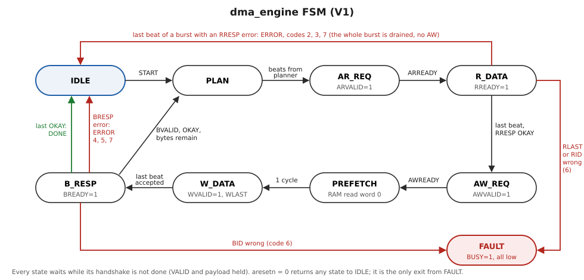

# Engine FSM (`rtl/dma_engine.vhd`)

## States

| State | AXI outputs | Leaves when | Next state |
|---|---|---|---|
| `IDLE` | none, `BUSY = 0` | START pulse from the register block (command already checked) | `PLAN` |
| | | SOFT_RESET pulse | stays `IDLE`; clears error code and counters |
| `PLAN` | none | always (1 cycle); latches N = planner output | `AR_REQ` |
| `AR_REQ` | `ARVALID = 1`, `ARADDR = src_cur`, `ARLEN = N-1` | `ARREADY = 1` | `R_DATA` |
| `R_DATA` | `RREADY = 1`, buffer write on each beat | `RLAST` wrong for the beat index, or `RID /= 0` | `FAULT` (code 6) |
| | | last beat, an RRESP error was seen in this burst | `IDLE` with ERROR (code 2, 3 or 7) |
| | | last beat, all OKAY | `AW_REQ` |
| `AW_REQ` | `AWVALID = 1`, `AWADDR = dst_cur`, `AWLEN = N-1` | `AWREADY = 1` | `PREFETCH` |
| `PREFETCH` | RAM read of word 0 | always (1 cycle) | `W_DATA` |
| `W_DATA` | `WVALID = 1`, `WDATA` = RAM output, `WLAST` on beat N-1 | `WREADY = 1` on beat N-1 | `B_RESP` |
| `B_RESP` | `BREADY = 1` | `BVALID` with `BID /= 0` | `FAULT` (code 6) |
| | | `BVALID` with SLVERR / DECERR / EXOKAY | `IDLE` with ERROR (code 4, 5 or 7) |
| | | `BVALID` OKAY, bytes remain | `PLAN` (addresses += 4N) |
| | | `BVALID` OKAY, last segment | `IDLE` with DONE |
| `FAULT` | all VALID / READY low, `BUSY = 1` | `aresetn = 0` only | `IDLE` |

## Rules the FSM guarantees

- **VALID stability.** In `AR_REQ`, `AW_REQ` and `W_DATA` the VALID signal and its payload come
  from registers that do not change until the handshake. The RAM read for beat i+1 is enabled
  only when beat i is accepted.
- **No offer is withdrawn.** Nothing but a handshake or `aresetn` leaves `AR_REQ`, `AW_REQ`,
  `W_DATA` or `B_RESP`. There is no timeout.
- **Reset gating.** Every VALID / READY output is forced to 0 combinationally while
  `aresetn = 0`.
- **CYCLE_COUNT** counts every cycle with `state /= IDLE`, from the cycle after START to the
  terminal event, and saturates at `0xFFFFFFFF`.
- **BYTES_COMMITTED** grows only on an OKAY B response, by the size of that burst.
- `FAULT` keeps `BUSY = 1`, so a SOFT_RESET is refused (SLVERR). A protocol violation means the
  peer is broken; the DMA does not claim it can recover alone.
