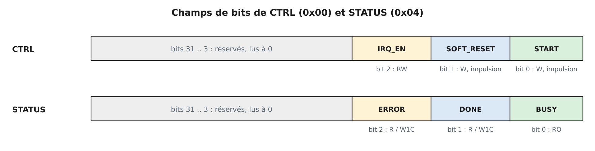

# Register map and software control

[Project overview](../README.md) · [Architecture](ARCHITECTURE.md) · [Error handling](ERROR_POLICY.md)

The [AXI4-Lite register block](../rtl/dma_axi_lite_regs.vhd) has 32-bit data and a six-bit local address. All offsets below are relative to the DMA's base address in the system. Addresses and transfer lengths are expressed in bytes.

## Register overview

| Offset | Register | Access | Reset | Meaning |
|---|---|---|---|---|
| `0x00` | `CTRL` | Read/write; command bits are pulses | `0x00000000` | START, SOFT_RESET and interrupt enable. |
| `0x04` | `STATUS` | Read; DONE and ERROR are write-one-to-clear | `0x00000000` | BUSY, DONE and ERROR. |
| `0x08` | `SRC` | Read/write while idle | `0x00000000` | Source address. |
| `0x0C` | `DST` | Read/write while idle | `0x00000000` | Destination address. |
| `0x10` | `LEN` | Read/write while idle | `0x00000000` | Number of bytes to copy. |
| `0x14` | `LAST_ERROR` | Read-only | `0x00000000` | Error code; see [Error handling](ERROR_POLICY.md). |
| `0x18` | `BYTES_COMMITTED` | Read-only | `0x00000000` | Bytes acknowledged by successful write responses. |
| `0x1C` | `CYCLE_COUNT` | Read-only | `0x00000000` | Engine cycle counter. |
| `0x20` | `VERSION` | Read-only | `0x00010000` | V1 version identifier. |

Unimplemented bits read as zero. Unmapped or unaligned accesses return DECERR.

## CTRL and STATUS bits



*The figure identifies the command bits in CTRL and the status bits in STATUS. “Impulsion” means a one-cycle command pulse; “effacement” means clearing a stored flag.*

| Register | Bit | Name | Behavior |
|---|---:|---|---|
| `CTRL` | 0 | `START` | Writing one requests a new transfer. It reads as zero. |
| `CTRL` | 1 | `SOFT_RESET` | Writing one clears idle configuration, status and counters. It reads as zero. |
| `CTRL` | 2 | `IRQ_EN` | Stores the interrupt-enable value. This is the only CTRL bit read back. |
| `STATUS` | 0 | `BUSY` | Read-only: one whenever the engine is outside `IDLE`, including `FAULT`. |
| `STATUS` | 1 | `DONE` | Sticky successful-completion flag. Write one to clear it while idle. |
| `STATUS` | 2 | `ERROR` | Sticky error flag. Write one to clear it and `LAST_ERROR` while idle. |

Writing zero to a write-one-to-clear status bit preserves it. Reading STATUS does not clear either flag. An accepted START clears DONE, ERROR and LAST_ERROR for the next command. A completion error clears DONE and sets ERROR.

The interrupt is a level signal:

```text
irq = IRQ_EN AND (DONE OR ERROR)
```

It remains asserted until software clears the corresponding status flags or disables interrupts when allowed. In `FAULT`, BUSY prevents software writes, so recovery requires external reset.

## A typical transfer

1. Check that BUSY is zero.
2. Write aligned source and destination addresses to SRC and DST.
3. Write a nonzero length divisible by four to LEN.
4. Write CTRL with START set. For example, `0x00000001` starts with interrupts disabled and `0x00000005` starts with interrupts enabled.
5. Poll DONE/ERROR or wait for the interrupt, then read the status and counters.
6. While idle, write `0x00000002` to STATUS to clear DONE, or `0x00000004` to clear ERROR and LAST_ERROR.

CTRL.IRQ_EN is updated from bit 2 whenever byte zero is enabled on an accepted ordinary CTRL write. A START write of `0x1` therefore also disables a previously enabled interrupt; use `0x5` to start with IRQ_EN set.

## Command validation

START is accepted only if all of these conditions hold:

- LEN is greater than zero.
- SRC, DST and LEN are divisible by four.
- `SRC + LEN` and `DST + LEN` are at most `2^32`, using a widened calculation to preserve overflow information.
- The half-open ranges `[SRC, SRC + LEN)` and `[DST, DST + LEN)` do not overlap.

An invalid START returns SLVERR, sets ERROR and LAST_ERROR to 1, and issues no AXI4 memory transaction. Rejection does not start the engine or reset its progress counters; counters from an earlier transfer can remain visible.

## Write-access rules

| Access | Result |
|---|---|
| CTRL, STATUS, SRC, DST or LEN write while BUSY is one | SLVERR; the active command is unchanged. |
| START and SOFT_RESET requested together | SLVERR; neither command is launched. |
| Valid SOFT_RESET while idle | OKAY; clears SRC, DST, LEN, DONE, ERROR, IRQ_EN, LAST_ERROR and engine counters. |
| Invalid START while idle | SLVERR; sets the invalid-command status described above. |
| Write to LAST_ERROR, BYTES_COMMITTED, CYCLE_COUNT or VERSION | SLVERR; read-only register. |
| Unmapped or unaligned address | DECERR. |

The register slave supports byte enables through AXI4-Lite WSTRB. SRC, DST and LEN merge only the selected bytes. CTRL and STATUS commands are masked by their byte enables, so their low-byte bits take effect only when `WSTRB[0]` is one. Master-side memory writes always use all four byte lanes.

## AXI4-Lite transaction behavior

Write address and write data are captured separately. AW may arrive before W, after W, or at the same time. A write is executed once both pieces are stored. The B response remains asserted and unchanged until BREADY accepts it.

Reads capture a register value into the response register. RVALID, RDATA and RRESP remain stable until RREADY accepts the response. There is one pending read response and one pending write response; configuration reads remain available while a transfer is active.

## Reading the counters correctly

`BYTES_COMMITTED` increases by the segment size only after an OKAY B response. It excludes a segment whose write response failed, even though some or all of that segment may have reached memory. A new accepted START resets this counter.

`CYCLE_COUNT` is reset when the engine accepts a new START and increments on each cycle outside IDLE, saturating at `0xFFFFFFFF`. It therefore stops after normal completion or a recoverable response error. In FAULT the engine remains outside IDLE, so the counter continues increasing until saturation or external reset. It measures engine activity; it does not include the preceding software register-programming sequence.
