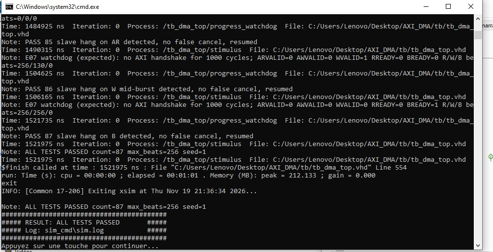
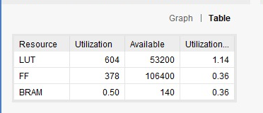
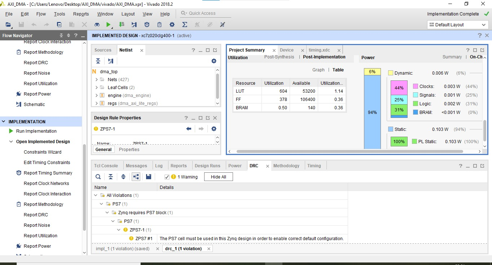
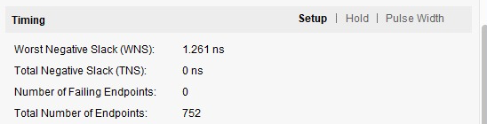
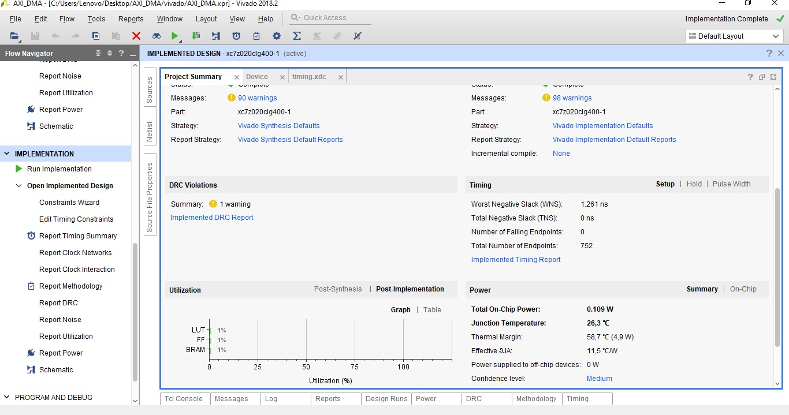
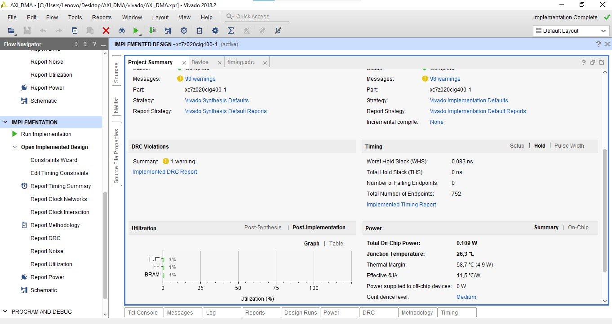
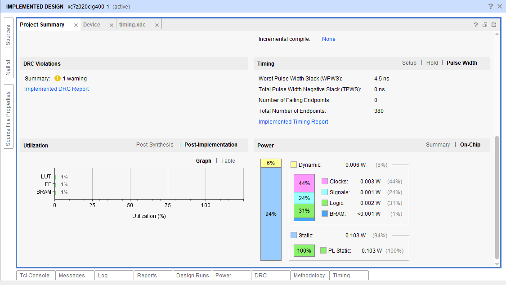
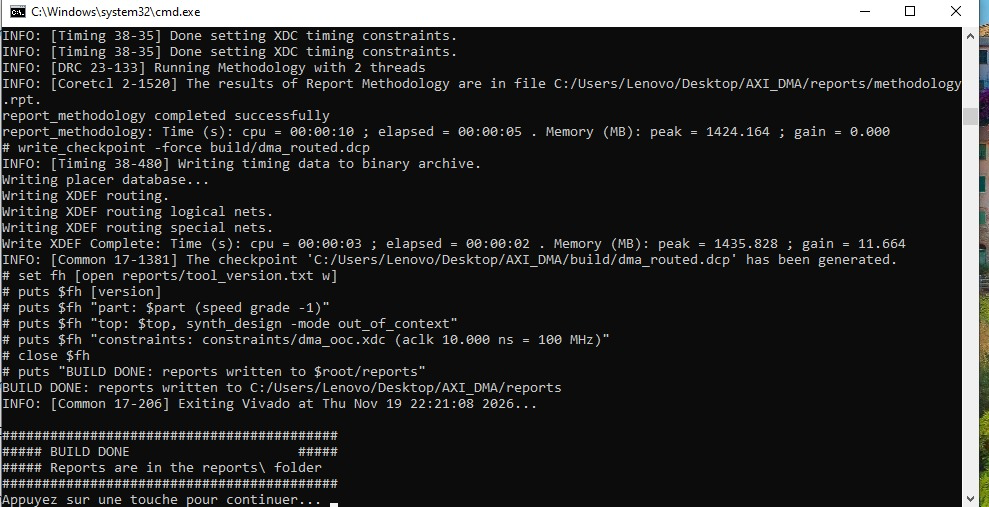
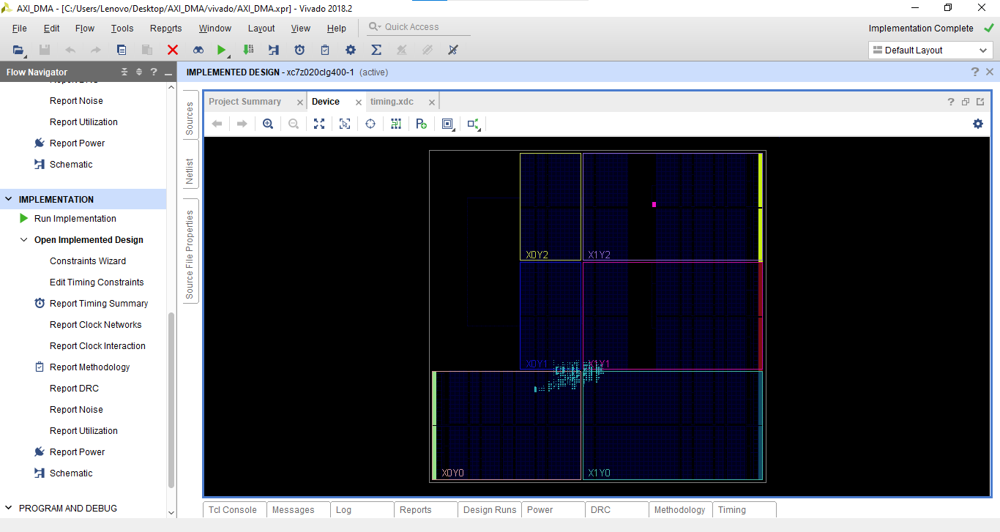

# Verification and implementation results

[Project overview](../README.md) · [Architecture](ARCHITECTURE.md) · [Waveform walkthrough](WALKTHROUGH.md)

The supplied material documents a V1 DMA that passes an 87-test XSim run and fits in a small fraction of a Zynq-7000 device. The screenshots below show selected simulation and implementation results. Performance numbers come from the testbench memory model; timing numbers describe the DMA block in isolation.

The repository includes the [RTL](../rtl), [self-checking testbench](../tb), [reproduction scripts](../scripts), [archived reports and result tables](../reports), and the [original French technical report](reference/AXI_DMA_V1_Technical_Report_FR.pdf). The tables below describe those archived results; they are distinct from any new run made on another machine.

## Evidence at a glance

| Result | Value | Evidence available here |
|---|---|---|
| Full XSim suite | 87 / 87 PASS; seed 1; maximum 256 beats | Native XSim console screenshot and report |
| Full GHDL suite | 87 / 87 PASS | [Per-test CSV](../reports/tests_seed1_b256.csv) and test summary |
| GHDL regression | 62 / 62 configurations PASS | [Regression CSV](../reports/regression_ghdl.csv) |
| Mutation checks | 12 / 12 injected bugs detected | [Mutation CSV](../reports/mutation_ghdl.csv) |
| 1 KiB copy, no stalls | 524 cycles; approximately 195 MB/s at 100 MHz | Test 8 in the [per-test CSV](../reports/tests_seed1_b256.csv) |
| FPGA resources | 604 LUTs, 378 FFs, one RAMB18 | [Utilization report](../reports/utilization.rpt) and native screenshots |
| Setup / hold slack | +1.261 ns / +0.083 ns | [Timing report](../reports/timing_summary.rpt) and native screenshots |
| Timing scope | Internal paths of the isolated DMA, at 100 MHz | OOC build screenshot and boundary-assumptions document |

The archived CSV files contain 87 passing per-test entries, 62 passing regression entries and 12 detected mutation entries. These are recorded execution results; the screenshots provide a complementary visual record. Use the [reproduction instructions](REPRODUCING.md) to run the supplied implementation again.

## Functional simulation



**Native XSim console screenshot.** The visible verdict is `ALL TESTS PASSED count=87 max_beats=256 seed=1`, with simulation ending at **1,521,975 ns**. The final lines also show tests 85–87, which deliberately pause the memory model on AR, a write beat and B, then resume it. The watchdog messages in those cases are expected diagnostics.

The [self-checking testbench](../tb/tb_dma_top.vhd) combines full-memory comparison, AXI protocol monitors, transaction counters and watchdogs. Its coverage includes:

- Copies from 4 bytes through 32 KiB, including several bursts and successive commands.
- Four-byte alignment, legal lengths, overflow checks and rejected overlapping ranges.
- Source and destination 4 KiB boundaries, burst lengths and LAST placement.
- Random channel stalls and forced WREADY pauses on the first, middle and final write beats.
- Independent AXI4-Lite address/data arrival and held read/write responses.
- Read and write response errors, unexpected IDs, incorrect RLAST and reset during activity.
- Completion after the final write response, with acknowledged bytes counted separately.

The [waveform walkthrough](WALKTHROUGH.md) explains the captured cases. The report maps the test list to the guide's T01–T20 and E01–E07 requirements; E03 and E04 require concurrent reading and writing and are reserved for the planned V2 architecture.

### Regression and mutation checks

The [regression table](../reports/regression_ghdl.csv) records a 62-run GHDL campaign: seeds 1–50 at a maximum burst length of 256 beats, seeds 1–5 at both 16 and 64 beats, and seeds 1–2 at one beat. Every recorded configuration passes all 87 tests.

The [mutation table](../reports/mutation_ghdl.csv) lists twelve intentionally injected RTL bugs and the test or monitor that caught each one. The corresponding [script](../scripts/mutation_ghdl.py) creates temporary mutated copies for those runs. Examples include changing WDATA during a stall, asserting DONE before BVALID, skipping source-side 4 KiB splitting, accepting START while BUSY, and ignoring incorrect IDs. These checks assess whether the testbench can detect specific faults; they do not establish exhaustive correctness.

## Simulated copy performance

The benchmark uses 32-bit words, a 100 MHz clock and the report's AXI memory model. KiB means 1,024 bytes; MB/s is decimal millions of bytes per second. These are **simulation-derived copy rates**, rather than board or DDR measurements.

| Copy size | Memory-model stalls | Bursts | Cycles | Bytes / cycle | Copy rate at 100 MHz |
|---|---|---:|---:|---:|---:|
| 4 bytes | None | 1 | 14 | 0.29 | 29 MB/s |
| 16 bytes | None | 1 | 20 | 0.80 | 80 MB/s |
| 1 KiB | None | 1 | 524 | 1.954 | 195 MB/s |
| 1,028 bytes | None | 2 | 538 | 1.911 | 191 MB/s |
| 32 KiB | None | 32 | 16,768 | 1.954 | 195 MB/s |
| 1 KiB | Forced five-cycle WREADY pause | 1 | 528–529 | About 1.94 | About 194 MB/s |
| 8 KiB | Random channel stalls | 8 | 5,563 | 1.47 | 147 MB/s |

Without stalls, the reported cycle model is:

```text
cycles = 2 × words + 12 × bursts
```

For one four-word burst, the twenty cycles consist of one PLAN cycle, one AR address cycle, four read beats, one AW address cycle, one buffer-prefetch cycle, four write beats and eight cycles in B_RESP. The response latency belongs to this memory model. Register programming and subsequent status polling are outside this engine cycle count.

V1 reads an entire burst before writing it. With a four-byte data path, the long-transfer ceiling for this schedule is **two copied bytes per cycle**, or **200 MB/s at 100 MHz**, before burst overhead and stalls. A 1 KiB burst reaches approximately 97.7% of that bound. Different memory latency, interconnect contention or stalls change the achieved rate. V2's proposed two-buffer overlap has no measured result in this release.

## FPGA resource use

The target is **`xc7z020clg400-1`**, using **Vivado 2018.2**. The report characterizes `dma_top` with a maximum burst length of 256 beats.



**Native Vivado summary crop.** The displayed utilization is 604 LUTs, 378 FFs and 0.50 block-RAM tiles.

| Resource | Used | Available | Utilization |
|---|---:|---:|---:|
| LUTs | 604 | 53,200 | 1.14% |
| Flip-flops | 378 | 106,400 | 0.36% |
| RAMB18 blocks | 1 | 280 | 0.36% |
| DSP blocks | 0 | 220 | 0% |

One RAMB18 is half of one 36 Kb block-RAM tile, which explains Vivado's **0.50 BRAM** display. The data buffer holds 256 × 32 bits, or 1 KiB. The [utilization report](../reports/utilization.rpt) also confirms zero DSP blocks; the cropped summary displays LUT, FF and BRAM rows only.



**Native Vivado full view.** The design hierarchy includes `dma_top`, `dma_engine` and `dma_axi_lite_regs`. The visible DRC warning is **ZPS7-1: “Zynq requires PS7 block,”** also recorded in the [DRC report](../reports/drc.rpt). It reflects the absence of a processing-system block in this isolated Zynq design. The screenshots therefore do not establish a complete, DRC-clean Zynq system ready for board use. System integration remains a separate step.

## Timing at 100 MHz



**Native Vivado summary crop.** Setup WNS is +1.261 ns, TNS is 0 ns, and no endpoint fails among the 752 timed endpoints shown.



**Native Vivado setup view.** The full window identifies the device, Vivado version and completed implementation.



**Native Vivado hold view.** WHS is +0.083 ns and THS is 0 ns, with zero failing endpoints.

| Timing metric | Reported value | Interpretation within the constrained scope |
|---|---:|---|
| Setup WNS | +1.261 ns | Positive setup margin |
| Hold WHS | +0.083 ns | Positive hold margin |
| Pulse-width slack | +4.500 ns | Timing report and pulse-width screenshot below |
| Failing endpoints | 0 / 752 | Setup and hold views |
| Unconstrained internal endpoints | 0 | `check_timing` section of the timing report |



**Native Vivado pulse-width view.** The additional capture shows +4.500 ns worst pulse-width slack and zero failing pulse-width checks among 380 endpoints, matching the archived timing report.

The [critical-path report](../reports/critical_paths.rpt) identifies the AXI4-Lite command check and the burst planner as the two critical internal paths. They combine 32-bit arithmetic and comparisons in one cycle. The material demonstrates a **100 MHz characterization**; operation at approximately 114 MHz is only an estimate in the report and has not been verified by a build at that frequency.

### Scope of the timing conclusion

The build is **out of context (OOC)**: it implements the DMA block alone with a 10 ns clock. No input/output delays constrain the AXI boundary ports. The accompanying assumptions report 98 input ports without input delay and 160 output ports without output delay. Those boundary paths are excluded from the positive-slack conclusion.

The full system must connect the DMA to its interconnect and memory controller and then time those connections as internal paths. Positive OOC slack does not establish timing closure for that eventual system. See [Boundary assumptions](../constraints/BOUNDARY_ASSUMPTIONS.md) for reset requirements and interface-delay details.



**Native Vivado batch-console screenshot.** The visible output shows `synth_design -mode out_of_context`, the 10 ns clock description, generation of a routed checkpoint and `BUILD DONE`. The supplied [build script](../scripts/build_ooc.tcl), [tool-version record](../reports/tool_version.txt) and generated reports document this flow.

## Implemented device view



**Native Vivado device view.** The supplied capture shows the implemented DMA in the `xc7z020clg400-1` device, with the design visible in the fabric and Vivado reporting “Implementation Complete.” This is a physical-design view of the isolated block. It does not show a board measurement or establish complete-system integration.

## What remains to be demonstrated

Complete-system integration, timing of the connected AXI paths, post-synthesis simulation, a frequency sweep, a software driver and tests on a physical board are listed as future work. V2's two-buffer architecture is also planned. The supplied RTL and scripts allow the V1 results to be checked independently with the documented tools.

For the original tables, test list and code excerpts, see chapters 10–16 and the appendices of the [French technical report](reference/AXI_DMA_V1_Technical_Report_FR.pdf).
