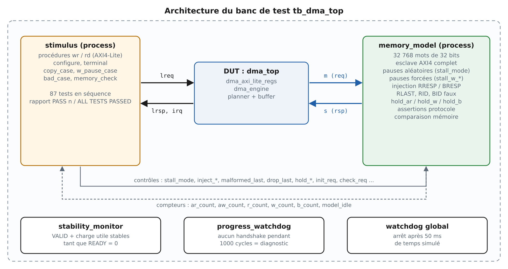

# Verification and evidence

[Project overview](../README.md) · [Architecture](ARCHITECTURE.md) · [Error handling](ERROR_POLICY.md) · [Results](RESULTS.md) · [Reproducing the results](REPRODUCING.md)

The main [self-checking testbench](../tb/tb_dma_top.vhd) programs the real top-level controller through AXI4-Lite and models an AXI4 memory on its master port. It checks data, protocol behavior, counters and terminal state automatically. A successful suite ends with `ALL TESTS PASSED count=87`.

## What is in the testbench?

*“Banc de test” means testbench. The stimulus process acts as software, the memory model acts as an AXI4 slave, and the scoreboard and monitors compare observed behavior with the expected results.*

| Component | What it does |
|---|---|
| AXI4-Lite driver | Writes configuration and reads status. Exercises address-before-data, data-before-address, byte strobes and delayed response acceptance. |
| Memory model | Owns 32,768 32-bit words, or 128 KiB, initialized to a deterministic pattern. Generates AXI4 responses and optional pauses or injected errors. |
| Memory scoreboard | After a successful copy, compares every word: destination data must match the source pattern and all words outside the destination must be unchanged. Selected rejected-command and read-error cases also check that memory is unchanged. |
| Protocol assertions | Check alignment, burst limits, 4 KiB boundaries, IDs, size, incrementing bursts, full write strobes, WLAST placement and the permitted outstanding transactions. |
| Stability monitor | Checks that VALID and the monitored payload fields remain stable while waiting for READY on the DMA master channels, memory responses and AXI4-Lite responses. |
| Transfer checks | Compare R/W/B beat counts, burst counts and BYTES_COMMITTED with the requested operation. |
| Terminal checks | Require the expected DONE or ERROR state and error code. Normal completion must leave the modeled memory interface idle. |
| Progress watchdog | Diagnoses 1,000 cycles of waiting without an AXI4 handshake; expected-stall tests verify the diagnostic without failing. |
| Global watchdog | Fails a simulation that reaches 50 ms of simulated time without finishing. |

The clock period is 10 ns. The memory model can insert independent random pauses on address, data and response progress, or force a five-cycle WREADY pause at a chosen beat. It can return response errors, corrupt RLAST or IDs, and stop responding on AR, W or B. These are simulation controls, not features or timeout logic added to the DMA.

## The 87-test main suite

The suite combines directed cases with 40 constrained-random commands. Seed `G_SEED` changes both the memory model's random pauses and the generated command sizes and addresses. Generic `G_MAX_BEATS` changes the DUT's maximum burst length.

| Test group | Main scenarios |
|---|---|
| Reset and software interface | Version and register reset values; AW/W skew; partial and zero strobes; response holding; invalid offsets; read-only writes; conflicting commands; SOFT_RESET. |
| Correct copies | 4 bytes through 32 KiB; lengths around the 256-beat boundary; source-only, destination-only and offset 4 KiB crossings. |
| Pauses and random traffic | Random independent stalls and 40 random copies; WREADY pauses at the first, middle and last beat. |
| Command rejection | Zero or non-word length; unaligned addresses; source or destination overflow; overlapping ranges; writes and commands while busy. |
| Completion and interrupts | Delayed B response, no early DONE, byte count, IRQ generation and write-one-to-clear status. |
| Response errors | R SLVERR and DECERR at the first, middle and last beat; B SLVERR and DECERR; unexpected R EXOKAY. |
| Protocol and reset | Early or missing RLAST; unexpected RID or BID; coordinated reset with an active address offer; successful restart. |
| Unresponsive receiver | Held ARREADY, WREADY or BVALID; no false completion or cancellation; transfer resumes when the receiver responds. |

The detailed mapping to guide tests T01-T20 and E01-E07 is in [TEST_SUMMARY.md](../reports/TEST_SUMMARY.md). E03 and E04 require overlapping read and write activity, so they belong to the planned V2 architecture and are not counted as V1 scenarios.

## Supplied campaign results

These are the recorded results supplied with the project. The linked raw tables provide the individual rows; reproduction instructions are separate from the historical evidence.

| Campaign | Configuration | Supplied result | Evidence |
|---|---|---|---|
| Main XSim suite | Vivado 2018.2; seed 1; 256 beats | 87/87 PASS; simulation ends at 1,521,975 ns | [Test summary](../reports/TEST_SUMMARY.md) and the XSim screenshot in [Results](RESULTS.md). |
| Main GHDL suite | GHDL 4.1.0; seed 1; 256 beats | 87/87 PASS; same end time | [Per-test table](../reports/tests_seed1_b256.csv). |
| GHDL regression | 50 seeds at 256 beats; seeds 1-5 at 16 and 64 beats; seeds 1-2 at 1 beat | 62/62 runs PASS | [Regression table](../reports/regression_ghdl.csv). |
| Mutation campaign | Twelve deliberately changed RTL variants | 12/12 detected | [Mutation table](../reports/mutation_ghdl.csv). |

The 62-run campaign is a matrix of complete suite executions, not 62 individual test cases. Each recorded run contains 87 tests.

The supplied [XSim regression launcher](../scripts/run_regression.bat) defines a separate 11-configuration matrix. Its generated `reports/regression_xsim.csv` is not part of the supplied evidence, so no completed 11-run result is claimed here.

## Separate burst-planner unit test

[tb_dma_burst_planner.vhd](../tb/tb_dma_burst_planner.vhd) is an additional focused testbench. It checks four command-validation examples, including the top of the 32-bit address space and touching but non-overlapping ranges. It then checks 8,192 planner cases: all 1,024 aligned source offsets within a 4 KiB page, each with eight destination/length combinations.

The testbench checks both the expected burst length and the legal range of 1-256 beats, then prints `PLANNER TESTS PASSED cases=8192 plus command validation`. The provided main-suite launchers do not run this unit test, and it is not included in the 87-test count or the supplied 62-run CSV.

## Why inject bugs?

A passing testbench should also detect plausible mistakes. The [mutation script](../scripts/mutation_ghdl.py) makes temporary RTL copies, changes one behavior in each copy and reruns the main suite. Original source files are not modified.

The twelve mutations cover ignored RID/BID errors, missing RLAST, undersized bursts, RAM advancement during WREADY stalls, early DONE, omitted source-side 4 KiB splitting, an incorrect read error code, writing a failed read segment, withdrawing ARVALID, accepting START while busy, and allowing overlapping ranges.

The recorded [mutation CSV](../reports/mutation_ghdl.csv) identifies the first detecting test and diagnostic for each variant. Examples include `W changed while stalled`, `Terminal before AXI completion` and `Unexpected number of bursts`.

## Interpreting the scripts and results

The GHDL regression launcher marks a run PASS only when the simulation log contains `ALL TESTS PASSED`. The Windows XSim launchers use the same verdict marker. The Python log converter extracts per-test PASS lines and reported metrics; a generated CSV alone is not a fresh simulation or proof that its input log reached the final success marker.

The existing mutation script needs its summary and CSV to be inspected: it does not return a failing process status when a mutant survives, fails to build, or cannot be applied. It classifies a timeout or a run without the final PASS marker as detected; an unexpected simulator failure therefore needs examination before being accepted as a useful detection. The supplied table records concrete failure messages for all twelve mutants.

These checks provide evidence for the implemented V1 subset and the stated test model. They do not replace hardware testing, complete-system timing analysis or additional cases for future architectural features. The [reproduction guide](REPRODUCING.md) covers tool requirements and running the supplied flows.
