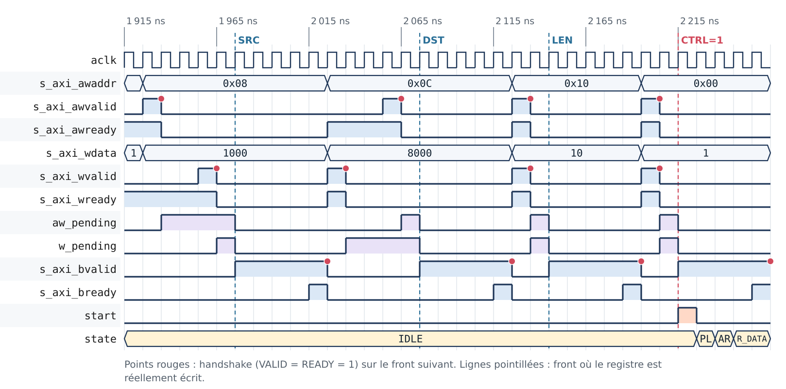
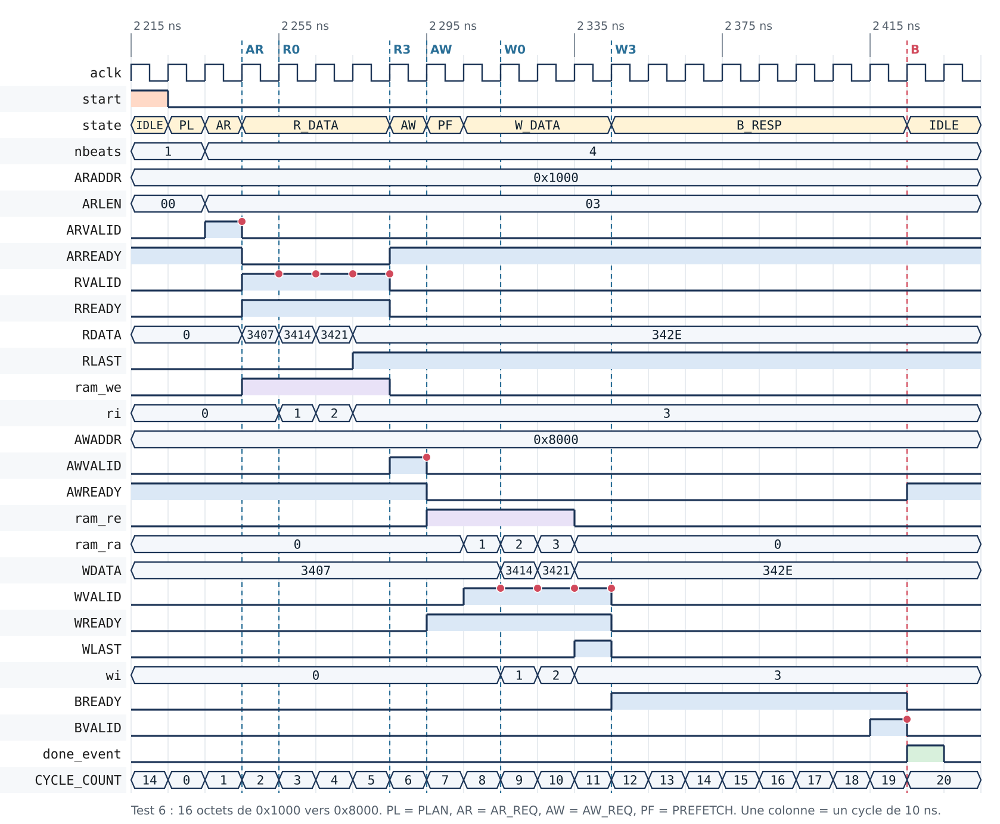
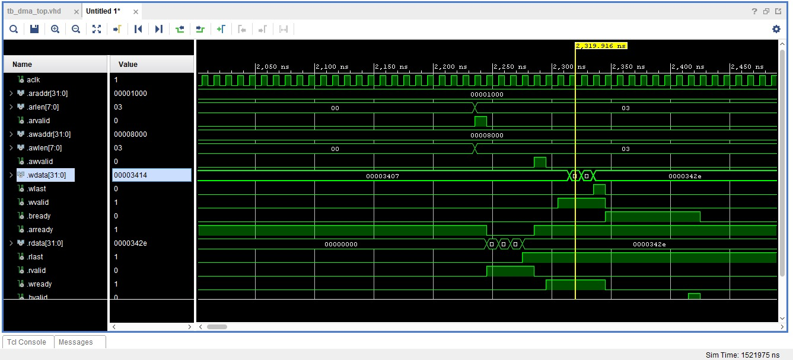
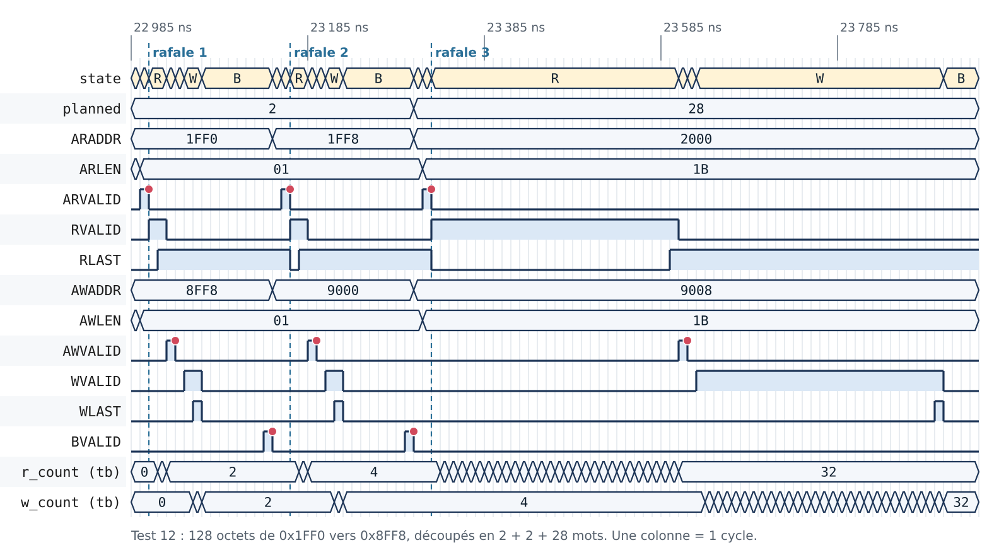
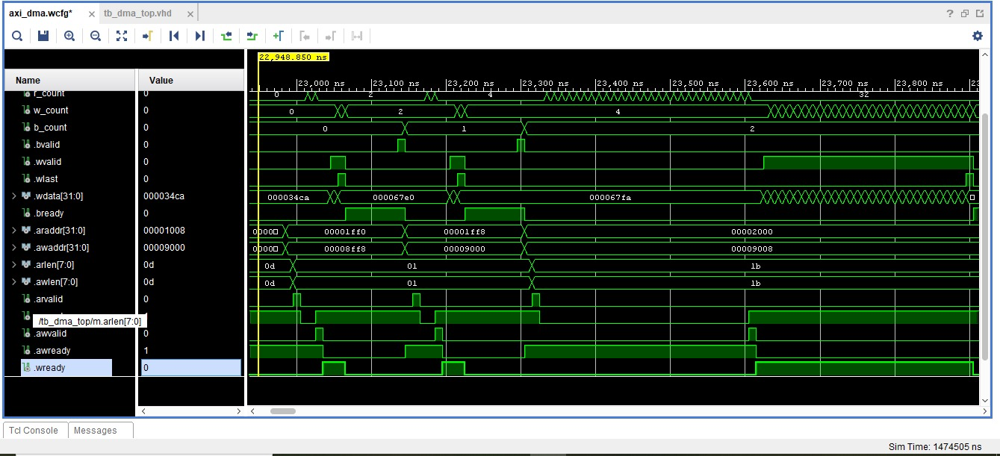
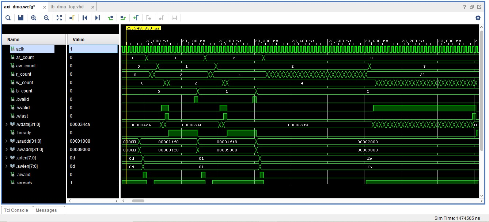
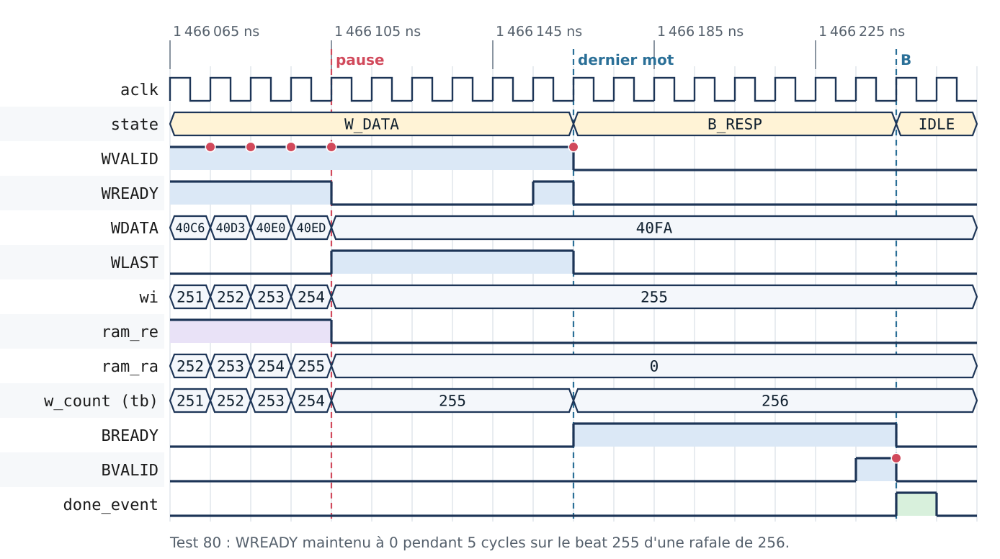
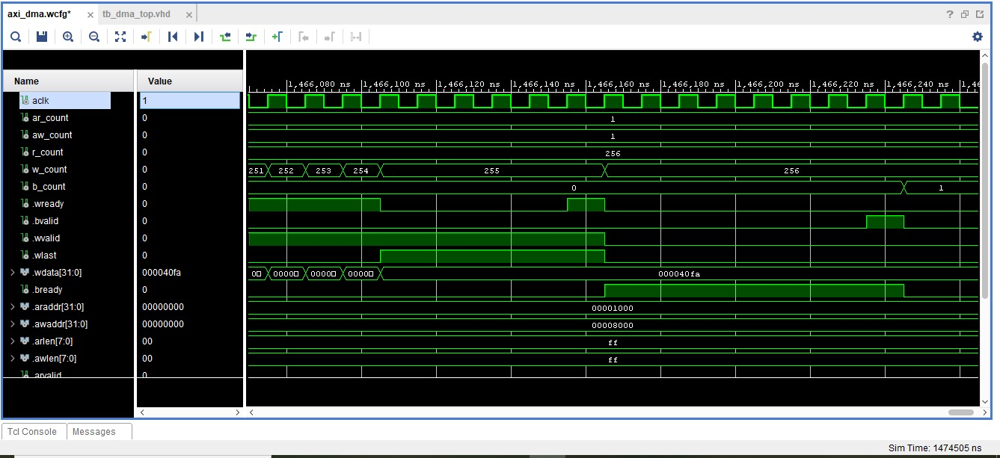
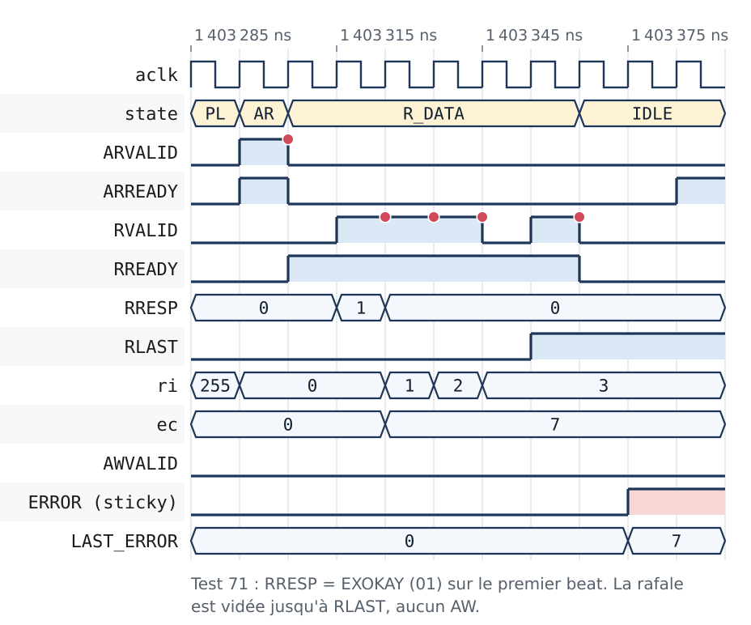
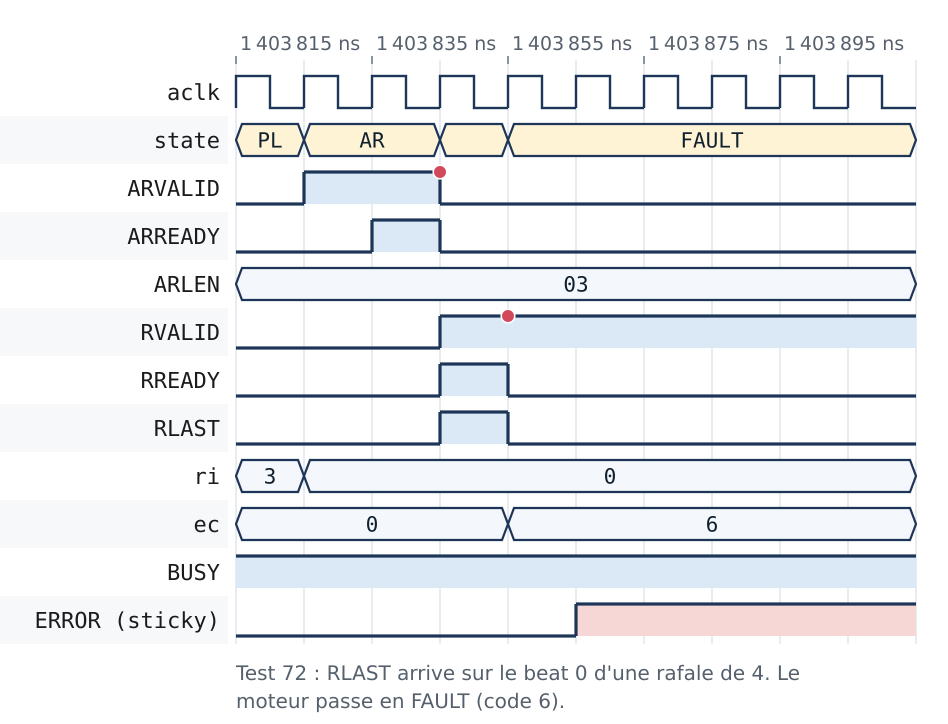

# Follow a transfer through the DMA

[Project overview](../README.md) · [Architecture](ARCHITECTURE.md) · [Results](RESULTS.md)

This walkthrough follows a 16-byte copy, then shows what changes at a 4 KiB boundary, during a stall and after an error. It uses the supplied V1 captures and the [French technical report](reference/AXI_DMA_V1_Technical_Report_FR.pdf), chapters 10–12.

Two kinds of figures appear below. **Native XSim screenshots** are captures from the simulator. **Redrawn chronograms** are explanatory diagrams prepared from the documented scenarios; they make the signals easier to read but are not additional simulator runs. Some original figure annotations are in French; the accompanying English captions explain each case.

## Reading the signals

Every transfer is accepted on a rising clock edge when that channel's **VALID and READY are both high**. VALID means an address, data beat or response is available; READY means the receiving side can accept it. When VALID is high and READY is low, the sender holds VALID and its payload unchanged.

The clock period in these examples is **10 ns**, or 100 MHz. A **beat** is one accepted 32-bit word, equal to four bytes. AR carries a read address, R carries read data, AW carries a write address, W carries write data, and B carries the write response. `ARLEN` and `AWLEN` encode the number of beats minus one: a four-beat burst uses `LEN = 3`.

## 1. Program a 16-byte copy

The host writes the control registers through the AXI4-Lite slave. In the testbench, the host is a bus driver rather than a physical processor.

| Write order | Register offset | Value | Meaning |
|---|---|---|---|
| 1 | `0x08` — SRC | `0x00001000` | Read from address `0x1000` |
| 2 | `0x0C` — DST | `0x00008000` | Write to address `0x8000` |
| 3 | `0x10` — LEN | `0x00000010` | Copy sixteen bytes |
| 4 | `0x00` — CTRL | `0x00000001` | Issue START; interrupt disabled in this example |



**Redrawn chronogram — register programming.** The SRC write sends its address before its data; the DST write sends its data first. The register block captures AW and W independently, performs the write after both are available, and holds the B response until accepted. In this example, the CTRL write executes at 2,215 ns and generates a one-cycle `start` pulse. The engine accepts that pulse at 2,225 ns.

Before allowing START, the design checks that source, destination and length are multiples of four, length is nonzero, neither range exceeds the address space, and the ranges do not overlap. Invalid commands return an error instead of issuing memory transactions. Writes that would reconfigure a busy DMA are rejected.

## 2. Read, buffer, write and acknowledge

The nominal example is **test 6**. The memory model initializes the four source words to `0x3407`, `0x3414`, `0x3421` and `0x342E`. Successful completion means those same words appear at `0x8000` through `0x800C`, and memory outside the destination remains unchanged.

The engine follows this sequence:

```text
IDLE → PLAN → AR_REQ → R_DATA → AW_REQ → PREFETCH → W_DATA → B_RESP → IDLE
```

1. **PLAN** selects four beats for this segment.
2. **AR_REQ** offers the source address with `ARLEN = 3`.
3. **R_DATA** accepts four words into the burst buffer and checks RLAST on the fourth.
4. **AW_REQ** offers the destination address with `AWLEN = 3`.
5. **PREFETCH** loads the first word from the synchronous buffer RAM.
6. **W_DATA** sends the four buffered words, with WLAST on the fourth.
7. **B_RESP** waits for the memory's write response. An OKAY response completes the segment; the final segment produces DONE.



**Redrawn chronogram — the complete copy.** Each column is one 10 ns clock cycle. PL, AR, AW and PF abbreviate PLAN, AR_REQ, AW_REQ and PREFETCH. The diagram exposes buffer enables, word indices and the engine's cycle counter. All read beats finish before the write address is issued: this is V1's **store-and-forward** schedule.



**Native XSim screenshot — nominal copy.** The source and destination are `0x1000` and `0x8000`, with `ARLEN = AWLEN = 3`. Read data arrives before the corresponding write sequence. WLAST marks the final word, and the B response occurs after the write data.

The documented handshake edges are:

| Clock edge | Accepted event |
|---|---|
| 2,245 ns | Read address AR |
| 2,255–2,285 ns | Four R beats; RLAST on the fourth |
| 2,295 ns | Write address AW |
| 2,315–2,345 ns | Four W beats; WLAST on the fourth |
| 2,425 ns | Final B response, then the engine's completion event |

The engine records **20 cycles** from its START acceptance to completion. The register block subsequently latches sticky DONE; the host observes `BYTES_COMMITTED = 16` and `CYCLE_COUNT = 20`. Programming the registers and reading the result take additional host-side time. The [performance discussion](RESULTS.md#simulated-copy-performance) explains the twenty-cycle total.

## 3. Split a copy at both 4 KiB boundaries

Test 12 copies **128 bytes from `0x1FF0` to `0x8FF8`**. A segment must fit within the remaining length, the configured burst limit, the source page and the destination page. Here, the destination boundary is reached first, followed by the source boundary.

| Segment | Source address | Destination address | Beats | Bytes | ARLEN / AWLEN | Reason for this size |
|---|---|---|---:|---:|---|---|
| 1 | `0x1FF0` | `0x8FF8` | 2 | 8 | `1` | Destination reaches `0x9000` |
| 2 | `0x1FF8` | `0x9000` | 2 | 8 | `1` | Source reaches `0x2000` |
| 3 | `0x2000` | `0x9008` | 28 | 112 | `27` (`0x1B`) | Copy the remaining bytes |



**Redrawn chronogram — 2 + 2 + 28 words.** “Rafale” means burst. After each successful B response, the engine advances both addresses by the segment size, reduces the remaining length and plans again. The total is 32 words, or 128 bytes.



**Native XSim screenshot — boundary split.** The address and length changes expose the three segments. The next read request starts only after the previous segment's B response, so V1 keeps one segment in progress at a time.



**Native XSim screenshot — the same case with `aclk`.** The clock and cumulative counters help locate accepted beats. Source addresses progress through `0x1FF0`, `0x1FF8` and `0x2000`; destination addresses progress through `0x8FF8`, `0x9000` and `0x9008`. The final burst-length encoding is `0x1B`, meaning 28 beats.

## 4. Hold the final word while WREADY is low

Test 80 copies **1 KiB**, one burst of 256 words. The memory model forces a five-cycle pause just as the DMA presents word index 255, the final word.



**Redrawn chronogram — final-word pause.** “Pause” marks the stall; “dernier mot” means last word. WVALID stays high, WLAST stays high, WDATA stays at `0x000040FA`, and the accepted-write count remains at 255. The buffer does not advance to another word during the pause.



**Native XSim screenshot — final-word stability.** When READY returns, the final word is accepted at 1,466,165 ns, the write count becomes 256 and the engine waits for B. The response completes the transfer at 1,466,245 ns. Holding a valid final word is necessary even though no later data beat remains to send.

## 5. Drain a read burst after a response error

An ordinary read response error is handled differently from a malformed transaction. The DMA remembers the first response error and continues accepting the current read burst through its correctly placed last beat. It then reports ERROR and returns to IDLE **without writing that segment**.



**Redrawn chronogram — test 71.** The first beat carries `RRESP = 01` (EXOKAY), an unexpected response for this design's ordinary non-exclusive reads. The engine records error code 7, drains the four-word burst and issues no AW. Sticky ERROR and LAST_ERROR are updated after the engine reports the failure. The gaps in RVALID are memory-model stalls.

SLVERR and DECERR on R use the same drain-then-stop policy, with their own error codes. A B response error arrives after write data has already been sent: it stops the next segment and does not add the failed segment to `BYTES_COMMITTED`. That counter records successful acknowledgements; it is not a promise that a failed write left the destination unchanged.

## 6. Stop in FAULT after a protocol violation

Incorrect RLAST or an unexpected response ID means the peer has violated the expected transaction structure. V1 enters **FAULT** instead of attempting a new command.



**Redrawn chronogram — test 72.** The request is for four beats (`ARLEN = 3`), but RLAST appears on beat zero. The engine records protocol error code 6, drops its active AXI handshake outputs and remains BUSY in FAULT. ERROR is sticky. Only the external active-low `aresetn` reset exits this state; SOFT_RESET is rejected while BUSY. Recovery requires a coordinated reset of the DMA and its transaction peer.

A slave that simply pauses does not by itself cause FAULT. V1 has no internal timeout: it continues waiting with the required signal stability. The testbench watchdog diagnoses long inactivity, including the deliberate hang-and-resume cases in tests 85–87.

For test coverage and the implementation measurements, continue to [Results](RESULTS.md). The [Architecture](ARCHITECTURE.md) explains the modules behind these signals.
